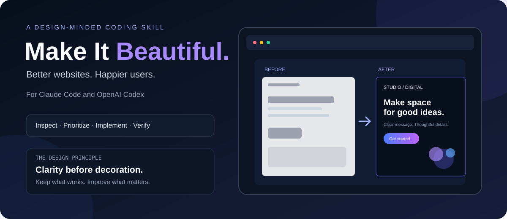
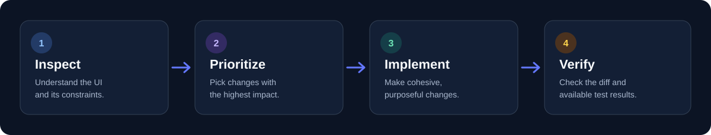

<div align="center">

# Make It Beautiful

**A design-minded skill for your coding agent.**

Turn “it works” into “this feels right.”

[](LICENSE)
[](#installation)
[](#installation)



**Better websites. Happier users.**

</div>

## Why this exists

Sometimes a page does the job, but it still feels unfinished. The spacing is a bit random, the headings don't guide your eye, or the mobile layout looks like an afterthought.

**Make It Beautiful** helps Claude Code and OpenAI Codex take a more deliberate pass at an existing interface. It encourages the agent to inspect the project first, focus on the changes that matter, and polish the details without breaking what already works.

No giant rewrite just for the sake of it. No extra dependencies for a tiny visual effect. Just better design decisions, implemented in the code you already have.

## What it focuses on

- **Visual hierarchy:** Make the main message and primary action easy to find.
- **Spacing and layout:** Build a consistent rhythm across the page.
- **Typography:** Improve readability, line length, and heading scale.
- **Color and contrast:** Make the interface coherent and keep text readable.
- **Responsive design:** Account for small screens, wrapping, and overflow.
- **Interaction states:** Consider focus, loading, disabled, success, and error states.
- **Existing behavior:** Preserve routes, content, data flow, and project conventions.

## Installation

The most reliable method is to copy `SKILL.md` into the skill folder for your agent. Skill discovery can vary by version, so use these paths if a CLI install command differs.

### Claude Code

Create this file in your project:

`.claude/skills/make-it-beautiful/SKILL.md`

Copy the contents of this repository's `SKILL.md` into it.

### OpenAI Codex

Create this file in your project:

`.agents/skills/make-it-beautiful/SKILL.md`

Copy the contents of this repository's `SKILL.md` into it.

Start or reopen your coding-agent session. Then ask the agent to use **Make It Beautiful**.

## Try it

Give your coding agent this prompt:

> Use Make It Beautiful to polish this page. Keep the current functionality, improve the visual hierarchy and spacing, and make the mobile layout feel intentional. Inspect the project first, then implement a focused set of changes.

Other ideas:

- Make this dashboard calmer and easier to scan without changing its data or interactions.
- Give this landing page a more editorial feel. Improve typography and spacing while keeping the brand intact.
- Review this form's labels, validation, focus states, and error messages.
- Don't edit yet. Identify the five highest-impact design improvements, ranked by impact and effort.


## The workflow



1. **Inspect** the actual page, components, styles, and project conventions.
2. **Prioritize** the highest-impact issues before changing code.
3. **Implement** a cohesive improvement, not a random collection of effects.
4. **Verify** with available checks and be honest about what could not be tested.

## A few principles

- Clarity comes before decoration.
- Use contrast to create emphasis, not to make everything shout.
- Don't add another card, gradient, shadow, or animation unless it helps.
- Keep keyboard access, visible focus, and readable contrast in mind.
- Reuse the project's components and design tokens where possible.
- Make purposeful changes rather than rewriting the whole app.

## Repository structure

```text
make-it-beautiful/
├── README.md
├── SKILL.md
├── LICENSE
├── CONTRIBUTING.md
├── CHANGELOG.md
├── assets/
│   ├── hero.svg
│   └── workflow.svg
├── examples/
│   └── prompt-examples.md
└── templates/
    └── design-brief.md
```

## Contributing

Found a rough edge or have an example that works well? Contributions are welcome. Please read [CONTRIBUTING.md](CONTRIBUTING.md) before opening a pull request.

## One honest note

Design is contextual. This skill gives your agent a stronger process, but you should still review the changes and run your project's checks. It explicitly asks the agent not to claim it tested a browser or ran commands when it didn't.

## Connect

- **LinkedIn:** [piyush2707](https://www.linkedin.com/in/piyush2707)
- **GitHub:** [@piyush2707](https://github.com/piyush2707)

If you use it on a project, I'd love to hear what improved.

---

<div align="center">

**Better websites. Happier users.**

</div>
